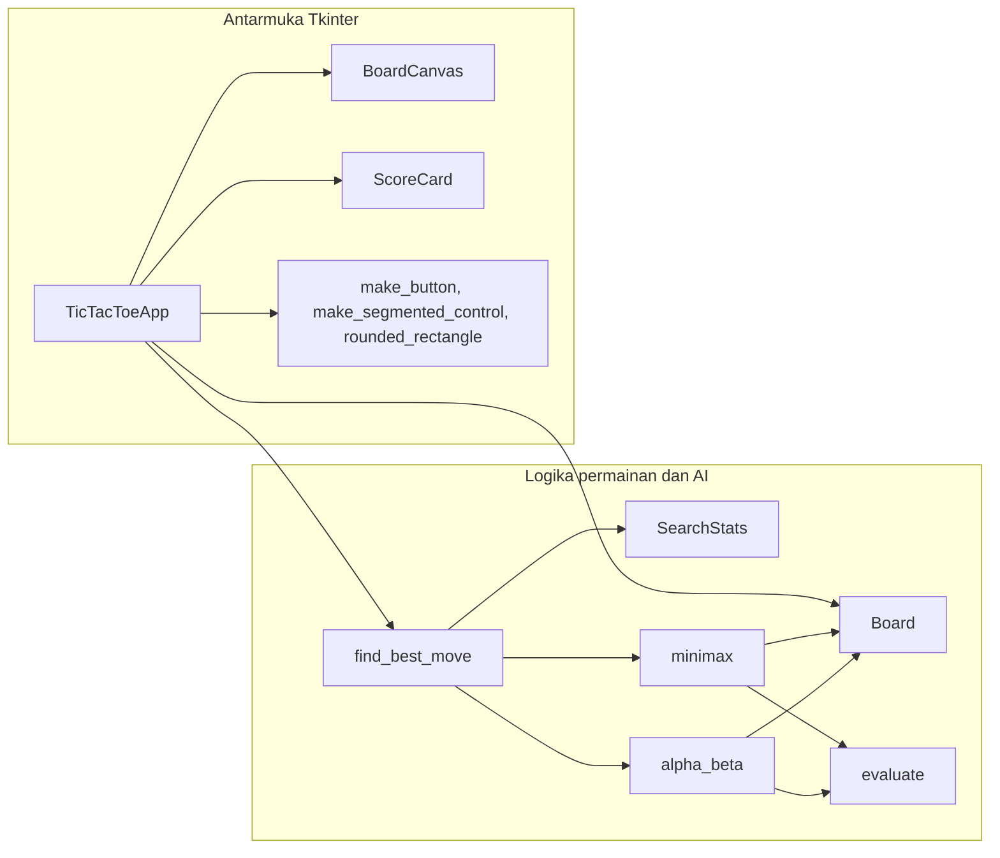
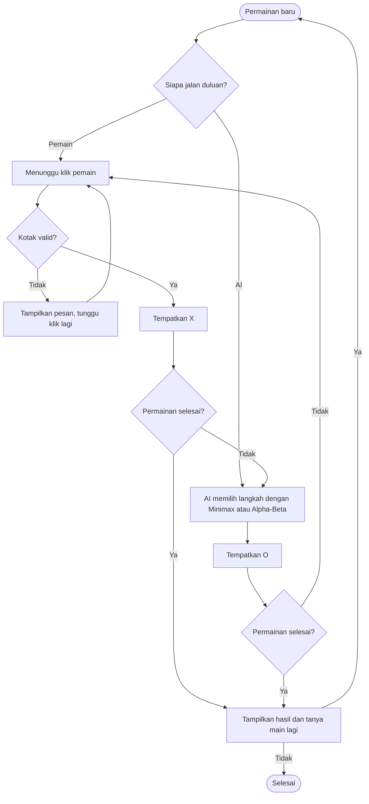
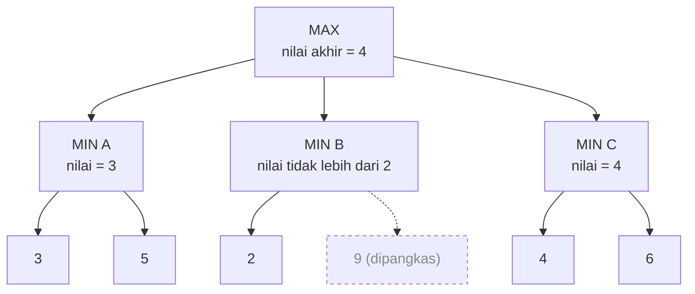
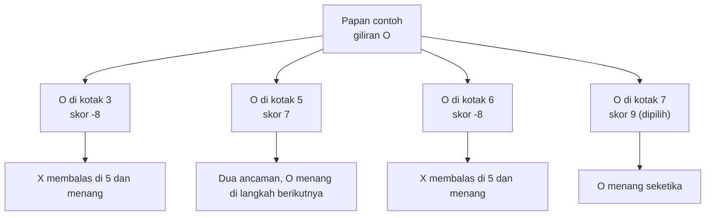
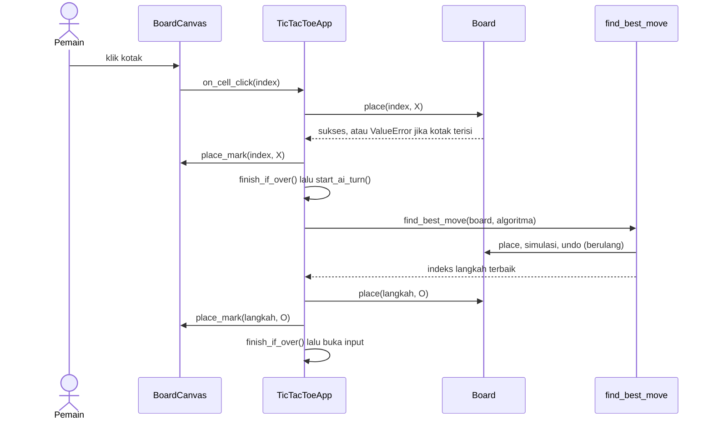

# Penjelasan Kode Tic Tac Toe AI: Minimax dan Alpha-Beta Pruning

Dokumen ini menjelaskan tiga hal:

1. Konsep **Minimax** dan **Alpha-Beta Pruning**.
2. Bagaimana kedua algoritma bekerja untuk memilih langkah terbaik.
3. Fungsi tiap bagian kode pada `tic_tac_toe_minimax.py`.

Semua angka (skor, jumlah simpul) pada dokumen ini diperoleh dengan menjalankan kode program secara langsung, bukan perkiraan.

## Isi dokumen

1. Gambaran umum program
2. Dasar teori
3. Proses algoritma memecahkan masalah (dengan contoh nyata)
4. Penjelasan kode bagian demi bagian
5. Kesesuaian dengan ketentuan soal
6. Pertanyaan yang mungkin muncul saat presentasi
7. Cara menjalankan

---

## 1. Gambaran Umum Program

Program dibagi menjadi dua lapisan yang terpisah: **logika permainan dan AI** (tidak tahu apa pun tentang tampilan) dan **antarmuka Tkinter** (hanya menampilkan dan meneruskan klik). Pemisahan ini membuat algoritma mudah diuji dan dijelaskan tanpa terganggu urusan tampilan.



Alur satu permainan secara keseluruhan:



---

## 2. Dasar Teori

### 2.1 Pohon permainan (game tree)

Setiap kondisi papan adalah sebuah **simpul**. Setiap langkah legal adalah **cabang** menuju kondisi papan berikutnya. Simpul paling akhir (ada pemenang atau papan penuh) disebut **simpul terminal**.

Tic Tac Toe cocok untuk Minimax karena memenuhi tiga sifat berikut:

- **Dua pemain bergantian** (X dan O).
- **Informasi sempurna**: kedua pemain melihat seluruh papan, tidak ada yang tersembunyi.
- **Zero-sum**: kemenangan satu pihak berarti kekalahan pihak lain.

Ukurannya cukup kecil sehingga seluruh pohon bisa ditelusuri sampai habis: dari papan kosong, pohonnya memiliki **549.946 simpul** (termasuk akar). Program menghitung 549.945 karena akar tidak ikut dihitung.

### 2.2 Minimax

Gagasan inti: AI menganggap lawannya **bermain sempurna**, lalu memilih langkah yang hasil terburuknya paling baik.

- Simpul **MAX** (giliran AI): memilih anak dengan nilai **terbesar**.
- Simpul **MIN** (giliran pemain): memilih anak dengan nilai **terkecil**, karena pemain berusaha merugikan AI.

Nilai dihitung dari bawah ke atas: daun diberi skor lewat fungsi evaluasi, lalu skor "naik" ke akar dengan aturan MAX atau MIN di tiap tingkat.

```text
function MINIMAX(state, depth, giliran_max):
    if state adalah terminal:
        return EVALUASI(state, depth)

    if giliran_max:
        terbaik = -tak_hingga
        for setiap langkah legal:
            terbaik = max(terbaik, MINIMAX(state setelah langkah, depth + 1, False))
        return terbaik
    else:
        terbaik = +tak_hingga
        for setiap langkah legal:
            terbaik = min(terbaik, MINIMAX(state setelah langkah, depth + 1, True))
        return terbaik
```

### 2.3 Fungsi evaluasi dan peran kedalaman

Pada kode ini, skor dihitung dari sudut pandang AI:

| Kondisi terminal | Skor |
| - | - |
| AI (O) menang | `10 - depth` |
| Pemain (X) menang | `depth - 10` |
| Seri | `0` |

`depth` ikut dikurangkan supaya AI punya selera yang masuk akal: **menang secepat mungkin** dan **kalah selambat mungkin**. Tanpa ini, AI menganggap menang dalam 1 langkah sama bagusnya dengan menang dalam 5 langkah, sehingga bisa saja ia "bermain-main" dulu padahal kemenangan sudah di depan mata.

| Kejadian | Kedalaman | Skor |
| - | - | - |
| AI menang | 1 | 9 |
| Pemain menang | 2 | -8 |
| AI menang | 3 | 7 |
| Pemain menang | 4 | -6 |
| AI menang | 5 | 5 |

Pada program, simulasi dimulai dari `depth = 1` untuk kondisi papan sesaat setelah AI menempatkan langkahnya di akar. Akibatnya, kemenangan AI selalu terjadi di kedalaman ganjil (1, 3, 5, ...) dan kemenangan pemain di kedalaman genap (2, 4, ...).

### 2.4 Alpha-Beta Pruning

Minimax memeriksa **semua** cabang, padahal sebagian besar tidak akan pernah memengaruhi keputusan. Alpha-Beta Pruning adalah optimasi yang **membuang cabang yang pasti tidak berguna**, dan hasilnya **identik** dengan Minimax biasa.

Dua nilai dibawa sepanjang pencarian:

- **alpha**: skor terbaik yang sudah *dijamin* bisa didapat oleh pihak MAX pada jalur ini (batas bawah).
- **beta**: skor terbaik yang sudah *dijamin* bisa didapat oleh pihak MIN pada jalur ini (batas atas).

**Aturan pemangkasan: jika `beta <= alpha`, hentikan pemeriksaan sisa anak.**

Alasannya intuitif. Misalkan AI sudah punya langkah A yang menjamin skor 4. Lalu ia mengecek langkah B, dan balasan pertama lawan terhadap B ternyata langsung membuat skor B maksimal 2. Lawan sudah punya cara membuat B lebih buruk dari A, jadi balasan lawan yang lain tidak perlu dilihat. B tidak akan pernah dipilih, seberapa pun buruknya.

```text
function ALPHA_BETA(state, depth, giliran_max, alpha, beta):
    if state adalah terminal:
        return EVALUASI(state, depth)

    if giliran_max:
        terbaik = -tak_hingga
        for setiap langkah legal:
            nilai   = ALPHA_BETA(state setelah langkah, depth + 1, False, alpha, beta)
            terbaik = max(terbaik, nilai)
            alpha   = max(alpha, terbaik)
            if beta <= alpha: break          # pemangkasan
        return terbaik
    else:
        terbaik = +tak_hingga
        for setiap langkah legal:
            nilai   = ALPHA_BETA(state setelah langkah, depth + 1, True, alpha, beta)
            terbaik = min(terbaik, nilai)
            beta    = min(beta, terbaik)
            if beta <= alpha: break          # pemangkasan
        return terbaik
```

#### Contoh abstrak

Pohon kecil dengan akar MAX dan tiga simpul MIN. Angka pada daun adalah skor terminal.



Penelusurannya, dari kiri ke kanan:

1. **A**: daun 3 dan 5, nilai A = min(3, 5) = 3. Akar menyimpan `alpha = 3`.
2. **B**: daun pertama bernilai 2, sehingga `beta = 2`. Karena `beta (2) <= alpha (3)`, daun **9 dipangkas**. Berapa pun nilainya, B tidak mungkin mengalahkan A.
3. **C**: daun 4 dan 6, nilai C = 4. Karena 4 > 3, `alpha` naik menjadi 4.
4. Akar memilih nilai terbesar: **4**, lewat cabang C.

Satu daun terlewati dan keputusan akhir tetap sama. Pada pohon yang jauh lebih besar, penghematannya berlipat-lipat.

### 2.5 Perbandingan dan kompleksitas

| Aspek | Minimax | Alpha-Beta |
| - | - | - |
| Langkah yang dipilih | Optimal | Sama persis dengan Minimax |
| Simpul yang diperiksa | Semua | Hanya yang relevan |
| Kompleksitas waktu | O(b^d) | Terburuk O(b^d), terbaik O(b^(d/2)) |
| Syarat | Tidak ada | Hasil paling hemat jika langkah bagus diperiksa lebih dulu (move ordering) |

`b` adalah jumlah cabang rata-rata dan `d` adalah kedalaman pohon. Kasus terbaik O(b^(d/2)) artinya pada waktu yang sama, Alpha-Beta bisa menelusuri pohon dengan kedalaman kira-kira dua kali lipat.

**Hasil pengukuran pada program ini** (langkah pertama AI, dari tiga situasi awal yang berbeda):

| Situasi | Simpul Minimax | Simpul Alpha-Beta | Selisih |
| - | - | - | - |
| AI jalan duluan (papan kosong) | 549.945 | 20.865 | sekitar 26 kali lebih sedikit |
| Pemain menaruh X di tengah | 55.504 | 2.458 | sekitar 23 kali lebih sedikit |
| Pemain menaruh X di pojok | 59.704 | 2.787 | sekitar 21 kali lebih sedikit |

Pada mesin pengujian, langkah pertama dari papan kosong memakan sekitar 0,7 detik dengan Minimax dan sekitar 0,05 detik dengan Alpha-Beta. Angka waktu di komputermu akan berbeda, tetapi perbandingannya serupa.

---

## 3. Proses Algoritma Memecahkan Masalah

### 3.1 Langkah-langkah umum

Saat giliran AI, fungsi `find_best_move` melakukan hal berikut:

1. **Representasikan keadaan.** Papan disimpan sebagai list 9 elemen (indeks 0 sampai 8).
2. **Bangkitkan langkah.** Ambil semua indeks kotak kosong lewat `available_moves()`.
3. **Coba satu langkah.** Taruh O di kotak itu dengan `place()`.
4. **Simulasikan lanjutannya.** Panggil `minimax` atau `alpha_beta` secara rekursif: bergantian X dan O menaruh simbol sampai papan mencapai kondisi terminal.
5. **Evaluasi daun.** Di kondisi terminal, hitung skor dengan `evaluate()`.
6. **Naikkan nilai ke atas.** Pada giliran O ambil skor terbesar (MAX), pada giliran X ambil skor terkecil (MIN).
7. **Batalkan langkah** dengan `undo()` (teknik *backtracking*), lalu coba kotak kosong berikutnya.
8. **Pilih yang terbaik.** Langkah dengan skor tertinggi di akar dipilih sebagai langkah AI.

Karena papan diubah langsung (`place`) lalu dikembalikan (`undo`), tidak ada salinan papan yang dibuat di setiap simpul. Ini hemat memori dan cepat.

### 3.2 Contoh nyata dengan Minimax

Misalkan papan seperti ini dan sekarang **giliran AI (O)**. Nomor kotak: baris atas 0-1-2, tengah 3-4-5, bawah 6-7-8.

```text
 X | O | X        kotak kosong: 3, 5, 6, 7
---+---+---
   | O |
---+---+---
   |   | X
```

Ancaman yang ada: O bisa langsung menang dengan mengisi kotak **7** (kolom 1-4-7). X sendiri mengancam menang dengan mengisi kotak **5** (kolom 2-5-8).

Hasil Minimax untuk tiap langkah O:

| Langkah O | Apa yang terjadi | Hasil | Skor |
| - | - | - | - |
| Kotak 3 | O mengancam menang di 5, tetapi X giliran duluan dan mengisi 5 sendiri, membentuk kolom 2-5-8 | X menang (kedalaman 2) | -8 |
| Kotak 5 | Memblokir X, sekaligus membuat dua ancaman (kotak 3 dan 7). X hanya bisa menutup satu | O menang (kedalaman 3) | 7 |
| Kotak 6 | Tidak memblokir, X mengisi 5 dan menang | X menang (kedalaman 2) | -8 |
| Kotak 7 | Langsung membentuk kolom 1-4-7 | O menang (kedalaman 1) | 9 |



Langkah **5** dan **7** sama-sama berujung kemenangan. Karena skor memperhitungkan kedalaman (9 melawan 7), AI memilih **7**: menang sekarang, bukan menang nanti. Inilah kegunaan `10 - depth`.

### 3.3 Contoh yang sama dengan Alpha-Beta

Minimax biasa memeriksa **33 simpul** pada papan ini. Alpha-Beta hanya **21 simpul** dan memilih langkah yang sama (kotak 7). Pemeriksaan dilakukan berurutan: kotak 3, 5, 6, 7.

| Tahap | Yang terjadi |
| - | - |
| Langkah 3 | Hasilnya -8. `alpha = -8`. |
| Langkah 5 | Hasilnya 7. `alpha` naik menjadi 7. Di dalam cabang ini sebagian pilihan lanjutan O dipangkas: X sudah punya satu balasan (kotak 3) yang bernilai 7, sehingga balasan X lain yang juga mentok di 7 tidak perlu diperiksa sampai habis. |
| Langkah 6 | Balasan X pertama yang diperiksa (kotak 3) ternyata memberi nilai 7, yang tidak lebih rendah dari `alpha = 7`. Sisa balasan X dipangkas. |
| Langkah 7 | Langsung menang, skor 9. `alpha = 9`. |

Perhatikan langkah 6. Padahal nilai sebenarnya langkah 6 adalah -8 (X menang di kotak 5), tetapi Alpha-Beta **tidak perlu tahu seberapa buruk**. Cukup diketahui bahwa langkah 6 tidak bisa lebih baik dari 7 yang sudah dipegang. Karena itu, skor yang dikembalikan untuk langkah yang kalah bersaing bisa berupa **batas** (bukan nilai pasti). Itu tidak masalah, sebab hanya langkah dengan skor tertinggi yang dipakai, dan nilainya selalu eksak.

---

## 4. Penjelasan Kode

### 4.1 Konstanta dan konfigurasi

```python
HUMAN = "X"
AI = "O"
EMPTY = ""
DRAW = "draw"
```

Simbol dan penanda hasil dipisahkan menjadi konstanta agar tidak ada "string ajaib" bertebaran dan mudah diubah.

```python
WINNING_LINES = (
    (0, 1, 2), (3, 4, 5), (6, 7, 8),  # baris
    (0, 3, 6), (1, 4, 7), (2, 5, 8),  # kolom
    (0, 4, 8), (2, 4, 6),             # diagonal
)
```

Delapan garis kemenangan pada papan 3x3, ditulis sebagai indeks kotak. Sebuah `tuple` dipakai karena isinya tidak pernah berubah.

`ALGORITHM_MINIMAX`, `ALGORITHM_ALPHA_BETA`, dan `ALGORITHM_LABELS` menamai pilihan algoritma. Blok "Pengaturan tampilan dan waktu" (`CELL_SIZE`, `CELL_GAP`, `AI_DELAY_MS`, `ANIMATION_SCALES`, dan lainnya) mengumpulkan semua angka tampilan di satu tempat. Mengubah ukuran papan atau kecepatan animasi cukup dengan mengganti angka di sini.

### 4.2 `Palette` dan `TONE_COLORS`

`Palette` menyimpan seluruh warna tema gelap sebagai atribut kelas. `TONE_COLORS` memetakan jenis pesan status (`info`, `thinking`, `warning`, `win`, `lose`, `draw`) ke warna teksnya. Dengan begitu `set_status("AI menang.", "lose")` otomatis berwarna merah tanpa perlu menulis kode warna di tempat lain.

### 4.3 Kelas `Board`: model papan

| Bagian | Fungsi |
| - | - |
| `cells` | List 9 elemen berisi `"X"`, `"O"`, atau `""` (kosong). |
| `available_moves()` | Mengembalikan indeks semua kotak kosong. Dipakai AI untuk membangkitkan cabang. |
| `place(index, symbol)` | Menaruh simbol. **Melempar `ValueError`** jika indeks di luar 0-8 atau kotak sudah terisi. Ini inti validasi input. |
| `undo(index)` | Mengosongkan kotak lagi. Dipakai AI untuk *backtracking*. |
| `winning_line()` | Mencari garis kemenangan; mengembalikan tuple tiga indeks atau `None`. Berguna juga untuk menggambar coretan kemenangan di UI. |
| `winner()` | Simbol pemenang, atau `None`. Dibangun di atas `winning_line()`. |
| `is_full()` | Benar jika tidak ada kotak kosong. |
| `is_game_over()` | Benar jika ada pemenang **atau** papan penuh (kondisi terminal). |

Pengecekan seri sederhana: jika tidak ada pemenang dan papan sudah penuh, hasilnya seri.

### 4.4 `SearchStats`

```python
@dataclass
class SearchStats:
    nodes: int = 0
```

Penghitung jumlah simpul yang dikunjungi. Objek yang sama dikirim ke seluruh rekursi sehingga angkanya terakumulasi. Inilah sumber angka "549.945 simpul" yang tampil di panel UI dan memungkinkan perbandingan kedua algoritma secara langsung.

### 4.5 `evaluate(board, depth)`

Mengubah kondisi terminal menjadi skor: `10 - depth` bila AI menang, `depth - 10` bila pemain menang, `0` untuk seri (lihat bagian 2.3).

### 4.6 `minimax(board, depth, is_maximizing, stats)`

```python
stats.nodes += 1
if board.is_game_over():
    return evaluate(board, depth)

symbol = AI if is_maximizing else HUMAN
best: float = -math.inf if is_maximizing else math.inf
for move in board.available_moves():
    board.place(move, symbol)
    score = minimax(board, depth + 1, not is_maximizing, stats)
    board.undo(move)
    best = max(best, score) if is_maximizing else min(best, score)
return int(best)
```

- `stats.nodes += 1` menghitung setiap simpul yang dikunjungi.
- Kasus dasar rekursi: jika permainan selesai, kembalikan skor.
- `is_maximizing` menentukan siapa yang sedang bermain dan apakah mengambil `max` atau `min`.
- Pola `place` lalu `undo` di sekitar pemanggilan rekursif adalah *backtracking*.
- `best` diawali `-inf` (untuk MAX) atau `+inf` (untuk MIN) sebagai nilai awal netral. Karena `math.inf` bertipe `float`, variabel diberi anotasi `float` dan hasilnya dikonversi `int(best)` sebelum dikembalikan agar sesuai dengan tipe kembalian `int`. Hasil akhirnya selalu bilangan bulat karena semua daun bernilai bulat.

### 4.7 `alpha_beta(board, depth, is_maximizing, alpha, beta, stats)`

Struktur sama dengan `minimax`, ditambah dua hal:

```python
if is_maximizing:
    best = max(best, score)
    alpha = max(alpha, best)
else:
    best = min(best, score)
    beta = min(beta, best)
if beta <= alpha:
    break
```

- `alpha` dan `beta` diperbarui sesuai pihak yang sedang bermain.
- `break` menghentikan loop begitu `beta <= alpha`: sisa cabang tidak diperiksa sama sekali, sehingga `stats.nodes` tidak bertambah untuk cabang yang dilewati.

### 4.8 `find_best_move(board, algorithm, stats)`

Fungsi di tingkat akar yang dipanggil UI.

```python
for move in board.available_moves():
    board.place(move, AI)
    if algorithm == ALGORITHM_ALPHA_BETA:
        score = alpha_beta(board, 1, False, alpha, math.inf, stats)
    else:
        score = minimax(board, 1, False, stats)
    board.undo(move)

    if score > best_score:
        best_score = score
        best_move = move
    alpha = max(alpha, best_score)
```

- Untuk setiap kotak kosong, O ditaruh lalu skornya dihitung. Setelah AI jalan, giliran berikutnya adalah pemain, maka pemanggilan memakai `False` (bukan MAX) dan `depth = 1`.
- `score > best_score` (bukan `>=`) berarti pada skor imbang, **langkah yang lebih dulu ditemukan yang dipertahankan**. Aturan ini sama untuk kedua algoritma, sehingga pilihan langkahnya identik.
- Pada jalur Alpha-Beta, `alpha` ikut dibawa dan diperbarui di tingkat akar. Inilah yang membuat langkah-langkah berikutnya bisa dipangkas lebih awal.

### 4.9 Fungsi bantu antarmuka

**`rounded_rectangle`** menggambar persegi bersudut membulat. Tkinter tidak punya bentuk ini, jadi dibuat dengan `create_polygon(..., smooth=True)` dari 12 titik yang mengapit tiap sudut.

**`make_button`** membuat `tk.Button` bergaya flat dengan warna dasar dan warna hover. Efek hover dibuat dengan mengikat (`bind`) peristiwa `<Enter>` dan `<Leave>`.

**`make_segmented_control`** membuat pilihan bergaya tombol berdampingan dari `Radiobutton` dengan `indicatoron=False` (tanpa bulatan), sehingga yang terpilih tampak sebagai segmen berwarna aksen. Parameter `command` bersifat opsional; jika kosong, dipakai fungsi kosong `lambda: None` sebagai pengganti agar `Radiobutton` tetap menerima callback yang valid.

**`ScoreCard`** adalah `tk.Frame` kecil berisi judul dan angka skor. Method `set_value()` memperbarui angkanya.

### 4.10 `BoardCanvas`: papan yang digambar

Turunan dari `tk.Canvas`. Tugasnya menggambar papan dan menerjemahkan klik mouse menjadi nomor kotak.

| Bagian | Penjelasan |
| - | - |
| `_cell_bounds(index)` | Menghitung koordinat sudut kotak: `row, col = divmod(index, 3)`, lalu `x1 = CELL_GAP + col * (CELL_SIZE + CELL_GAP)` (dan serupa untuk `y1`). Dengan `CELL_SIZE = 120` dan `CELL_GAP = 8`, ukuran canvas 392 x 392 piksel. |
| `_index_at(x, y)` | *Hit test*: mencari kotak yang memuat titik klik. Mengembalikan `None` jika klik jatuh di celah. |
| `_handle_click` | Meneruskan klik ke callback `on_cell_click` **hanya jika** papan sedang `interactive`. |
| `_set_hover` | Mewarnai kotak kosong yang sedang dilewati mouse dan mengubah kursor menjadi tangan. Kotak terisi tidak mendapat efek hover. |
| `reset()` | Menghapus semua tanda dan coretan, lalu mengembalikan warna kotak. |
| `place_mark(index, symbol)` | Mencatat simbol di `self.cells` lalu memulai animasi. |
| `_animate_mark` | Menggambar tanda berulang dengan skala `ANIMATION_SCALES` (0,35 hingga 1,0, sempat sedikit melebihi 1 agar terasa "membal") tiap 18 ms memakai `after()`. Jika `self.cells[index]` sudah berubah (papan di-reset di tengah animasi), animasi berhenti. |
| `_draw_mark` | X digambar dengan dua garis bersilang, O dengan sebuah lingkaran (`create_oval`). Ukuran setengah sisi tanda = `CELL_SIZE * 0.26 * scale`. |
| `show_winner` / `_draw_winner` | Menunggu animasi tanda selesai, lalu mewarnai tiga kotak pemenang dan menarik garis hijau dari kotak pertama ke ketiga. Ada pengecekan bahwa papan belum di-reset. |

### 4.11 `TicTacToeApp`: jendela utama dan alur permainan

Turunan dari `tk.Tk`. Method terpenting:

| Method | Fungsi |
| - | - |
| `__init__` | Menyiapkan jendela, `Board`, skor, dan variabel Tkinter (`algorithm`, `first_player`, `status_text`, `search_text`), lalu membangun UI dan memulai permainan. |
| `_build_widgets`, `_build_board_panel`, `_build_side_panel` | Menyusun layout dua kolom: papan di kiri, skor + panel pencarian AI + pengaturan + tombol di kanan. |
| `set_status(text, tone)` | Mengganti teks status sekaligus warnanya. |
| `update_scores`, `reset_scores` | Menyinkronkan kartu skor dengan data. |
| `_set_locked(locked)` | Mengunci atau membuka input pemain, juga menonaktifkan hover. Dipakai agar pemain tidak bisa klik saat AI "berpikir". |
| `new_game()` | Membuat `Board` baru, mengosongkan tampilan, dan menentukan siapa yang mulai. |
| `on_cell_click(index)` | Menangani klik pemain: coba `board.place()`. Jika `ValueError` (kotak terisi), tampilkan pesan peringatan dan tunggu klik berikutnya. Jika sukses, gambar X, cek akhir permainan, lalu serahkan giliran ke AI. |
| `start_ai_turn()` | Mengunci input, menampilkan "AI sedang berpikir...", lalu menjadwalkan `ai_turn` dengan jeda `AI_DELAY_MS` agar terasa natural. |
| `ai_turn(game_id)` | Memanggil `find_best_move`, mengukur waktu dengan `time.perf_counter()`, menaruh O, dan menampilkan jumlah simpul serta waktunya di panel pencarian. |
| `finish_if_over()` | Mengecek terminal. Jika selesai: kunci input, tampilkan garis kemenangan, perbarui skor dan status, lalu jadwalkan dialog hasil. |
| `show_result_dialog` | Menampilkan hasil dan pertanyaan "Main lagi?" lewat `messagebox.askyesno`. |

**Mengapa ada `game_id`?** `after()` menjadwalkan fungsi untuk dijalankan nanti. Jika pemain menekan "Permainan Baru" saat AI masih menunggu giliran, panggilan lama tetap akan jalan dan menaruh O di papan baru. Setiap `new_game()` menaikkan `game_id`, dan callback yang membawa `game_id` lama langsung diabaikan.

Satu giliran lengkap, dari klik sampai AI membalas:



### 4.12 `main()`

```python
def main() -> None:
    app = TicTacToeApp()
    app.mainloop()

if __name__ == "__main__":
    main()
```

Blok `if __name__ == "__main__"` memastikan jendela hanya terbuka ketika file dijalankan langsung, bukan saat file di-`import` (misalnya untuk menguji fungsi AI secara terpisah).

---

## 5. Kesesuaian dengan Ketentuan Soal

| No. | Ketentuan | Implementasi |
| - | - | - |
| 1 | Papan 3x3 | `Board.cells` (9 elemen) dan `BoardCanvas` (grid 3x3). |
| 2 | Pemain X, AI O | Konstanta `HUMAN = "X"` dan `AI = "O"`. |
| 3 | Pemain memilih posisi kosong | `on_cell_click` memanggil `Board.place`. |
| 4 | AI memakai Minimax | `minimax` dipanggil oleh `find_best_move`. |
| 5 | Deteksi menang, kalah, seri | `Board.winner`, `Board.is_full`, `Board.is_game_over`, dan `finish_if_over`. |
| 6 | Tampilkan hasil dan opsi main lagi | `show_result_dialog` dan tombol "Permainan Baru". |
| 7 | Papan jelas tiap giliran | `BoardCanvas.place_mark` dan label status ("Giliran Anda", "AI sedang berpikir..."). |
| 8 | Cegah posisi terisi atau di luar papan | `Board.place` melempar `ValueError`; UI menampilkan pesan dan tidak mengubah papan. |
| Tantangan | Alpha-Beta Pruning | `alpha_beta` dan pilihan algoritma di panel pengaturan. Panel "Pencarian AI" menampilkan jumlah simpul dan waktu kedua algoritma. |

---

## 6. Pertanyaan yang Mungkin Muncul saat Presentasi

**Apakah AI ini bisa dikalahkan?**
Tidak. Tic Tac Toe adalah permainan yang sudah "terpecahkan": jika kedua pihak bermain sempurna, hasilnya seri. Minimax menelusuri seluruh kemungkinan, jadi AI tidak pernah salah langkah. Dalam pengujian 500 permainan melawan pemain acak, AI tidak pernah kalah. Hasil terbaik yang bisa diraih pemain adalah seri.

**Apakah Alpha-Beta mengubah keputusan AI?**
Tidak. Alpha-Beta hanya membuang cabang yang terbukti tidak memengaruhi hasil. Pada pengujian, kedua algoritma memilih langkah yang sama pada 142 posisi acak.

**Mengapa skor memperhitungkan kedalaman?**
Agar AI memilih kemenangan tercepat dan menunda kekalahan. Tanpa itu, semua kemenangan bernilai sama dan AI bisa menunda kemenangan tanpa alasan.

**Mengapa memakai `place` dan `undo`, bukan menyalin papan?**
Menyalin papan di setiap simpul berarti ratusan ribu salinan pada langkah pertama. Mengubah papan lalu mengembalikannya (backtracking) lebih hemat memori dan lebih cepat.

**Apa kelemahan Minimax pada permainan yang lebih besar (misalnya catur)?**
Jumlah simpul tumbuh eksponensial, O(b^d). Untuk permainan besar, pencarian harus dibatasi kedalamannya dan diganti dengan fungsi heuristik untuk menilai posisi yang belum selesai. Alpha-Beta membantu, dan lebih efektif lagi jika langkah yang menjanjikan diperiksa lebih dulu (*move ordering*).

**Mengapa jumlah simpul Alpha-Beta bisa berbeda-beda?**
Karena efektivitas pemangkasan bergantung pada urutan langkah yang diperiksa. Jika langkah terbaik ditemukan lebih awal, `alpha` naik cepat dan lebih banyak cabang terpangkas.

---

## 7. Cara Menjalankan

```bash
python tic_tac_toe_minimax.py
```

- Membutuhkan Python 3.8 atau lebih baru. Tkinter sudah termasuk pada instalasi Python di Windows dan macOS. Pada Linux mungkin perlu `sudo apt install python3-tk`.
- Tidak ada pustaka tambahan yang perlu dipasang.
- Untuk membandingkan algoritma: pilih "AI jalan duluan", jalankan sekali dengan Minimax, lalu sekali dengan Minimax + Alpha-Beta. Panel "Pencarian AI" akan menampilkan jumlah simpul dan waktu keduanya berdampingan.
